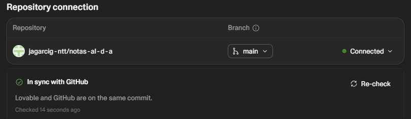
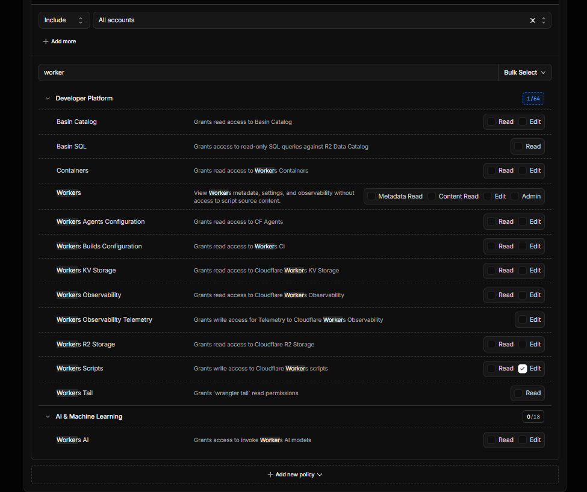
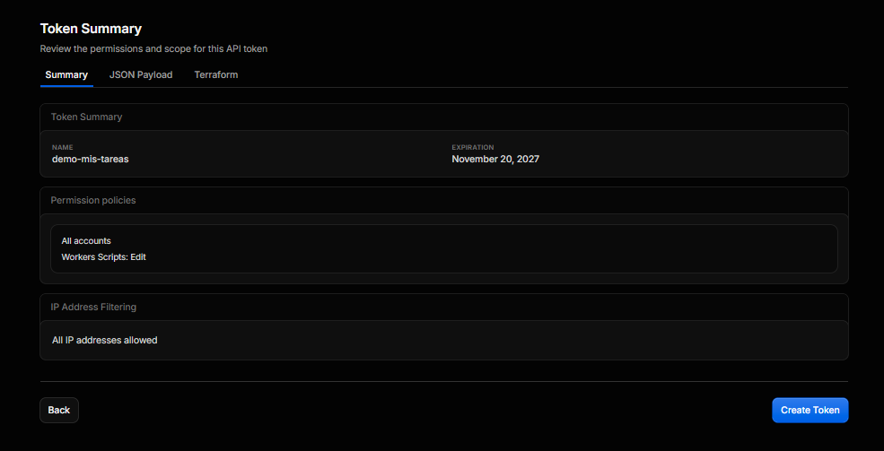
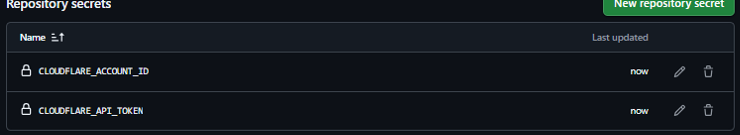

# Práctica: tu producto en producción

**AI PM Pro · The Hero Camp · Sesión "Git, Deployment y Producción" · 21 de noviembre**

Dos prácticas sobre **tu propio producto**, solo con el navegador:

- **Práctica 1 (10:30, primero en directo y después en salas):** tu primer despliegue. Al terminar, tu producto está en Internet.
- **Práctica 2 (11:50, primero en directo y después en salas):** tu primer cambio por Pull Request, con `main` protegida.

En los pasos verás dos datos tuyos:

- `<usuario>`: tu usuario de GitHub;
- `<repo>`: el nombre de tu repositorio.

**Antes de empezar:** abre tu proyecto en Lovable y **comprueba su nombre arriba a la izquierda**. Si tienes varios, es fácil equivocarse.

---

## Práctica 1 · Tu primer despliegue

### Paso 1 · Conecta Lovable con GitHub y haz público el repositorio
1. En Lovable, abre *Settings → Git* y conecta tu proyecto con GitHub. Si GitHub te pide autorizar a Lovable, acepta en tu cuenta personal.
2. Espera a ver **Connected** e **In sync with GitHub**.
3. Abre tu repositorio en GitHub y ve a *Settings → General*. Baja hasta *Danger Zone*.
4. Pulsa *Change visibility* y elige **Public**. Comprueba que pone *This repository is currently public*.

> **No renombres ni muevas el repositorio** después de conectarlo: Lovable perdería la conexión.

✅ **En el chat de Zoom:** escribe "conectado".

### Paso 2 · Crea el token de Cloudflare
**Deja de compartir pantalla** desde aquí hasta terminar el paso 3. El token es una contraseña y la sesión se graba.

1. En Cloudflare, entra en *Workers & Pages*. En la columna de la derecha está tu **Account ID**: déjala abierta.
2. Haz clic en tu perfil y ve a *My Profile → API Tokens → Create Token*.
3. **Token name:** el nombre de tu proyecto.
4. En **Policies**, pulsa *Start from scratch* y elige **Start with an Account policy**.
5. Deja `Include` · `All accounts`. En el buscador escribe `worker` y, en la fila **Workers Scripts**, marca **Edit**.

6. **Token expiration:** `1 year`. Pulsa *Continue to summary*.
7. Comprueba el resumen: **All accounts** y **Workers Scripts: Edit**. Pulsa *Create Token*.
8. **Copia el token.** Cloudflare solo lo enseña una vez. Si lo pierdes, crea otro.

### Paso 3 · Guarda el token y el Account ID en GitHub
1. En tu repositorio de GitHub, ve a *Settings → Secrets and variables → Actions*.
2. Pulsa *New repository secret*.
3. **Name:** `CLOUDFLARE_API_TOKEN`. **Secret:** tu token. Pulsa *Add secret*.
4. Repite con **Name:** `CLOUDFLARE_ACCOUNT_ID` y tu Account ID como **Secret**.
5. Comprueba que ves los dos, con estos nombres exactos. Ya puedes volver a compartir pantalla.

✅ **En el chat de Zoom:** escribe "secretos".

### Paso 4 · Pide a Lovable los tres ficheros
Pide los tres ficheros **uno a uno**, en tres mensajes. Lo más cómodo es el botón *Copiar* de la práctica 1 en el portal, que copia el mensaje con el fichero dentro. Desde esta guía, abre o descarga cada fichero y copia todo su contenido.

**1.1 Comprobación de cada cambio.** Escribe en el chat de Lovable y pega el contenido de [comprobar-pr.yml](../Lab/workflows/comprobar-pr.yml) a continuación:

> Crea el fichero `.github/workflows/comprobar-pr.yml` en la raíz del repositorio con este contenido exacto. No cambies nada, ni comentarios ni espacios, y no toques ningún otro fichero:

**1.2 Publicación automática.** Repite con [desplegar.yml](../Lab/workflows/desplegar.yml):

> Crea el fichero `.github/workflows/desplegar.yml` en la raíz del repositorio con este contenido exacto. No cambies nada, ni comentarios ni espacios, y no toques ningún otro fichero:

En cuanto llegue a GitHub, **empieza tu primera publicación**.

**1.3 Plantilla de Pull Request.** Repite con [pull_request_template.md](../Lab/workflows/pull_request_template.md):

> Crea el fichero `.github/pull_request_template.md` con este contenido exacto. No cambies nada y no toques ningún otro fichero:

✅ **En el chat de Zoom:** escribe "ficheros".

### Paso 5 · Mira cómo se publica
1. En GitHub, abre tu repositorio y la pestaña **Actions**.
2. Espera a que **Desplegar** salga con el círculo verde ✅. Tarda alrededor de un minuto.
3. Haz clic en **Desplegar**. En el resumen verás **Publicado en:** y tu dirección. Tiene esta forma: `https://<usuario>-<repo>.<tu-subdominio>.workers.dev`.

✅ **En el chat de Zoom:** pega tu URL de producción.

### Paso 6 · Prueba tu web
1. Abre tu URL.
2. **Haz lo principal de tu producto**: crear algo, guardar o enviar un formulario. Abrirla no basta: verde no significa que funcione.

### Paso 7 · Solo si tu producto tiene inicio de sesión
Sin este paso, el enlace del correo de confirmación te lleva a la vista previa de Lovable en lugar de a tu web.

1. En Lovable, abre **More → Users → Settings → Advanced** y busca **Allowed URLs**.
2. Pulsa *Add URL* y añade estas tres direcciones, con tus datos:
    - `https://<usuario>-<repo>.<tu-subdominio>.workers.dev` (tu web, tal cual, sin barra al final);
    - `https://<usuario>-<repo>.<tu-subdominio>.workers.dev/**`;
    - `https://*-<usuario>-<repo>.<tu-subdominio>.workers.dev/**` (las previews de tus Pull Requests).
3. Si en esa pantalla hay un campo **Site URL**, pon tu URL de producción.
4. **No borres las URL de Lovable** que ya hay: son las que hacen funcionar su vista previa.
5. Comprueba que funciona: regístrate desde tu web con un email nuevo y abre el enlace del correo.

### Si algo falla en la práctica 1

| Lo que ves | Qué significa | Qué hacer |
|---|---|---|
| No aparece nada en *Actions* | Los ficheros no han llegado a GitHub | Busca `.github/workflows/` en tu repositorio. Si no está, repite el paso 4 |
| **Desplegar** en rojo en el paso "0. Comprobar que existen los secretos" | Falta un secreto o tiene otro nombre | *Settings → Secrets and variables → Actions*: deben ser exactamente `CLOUDFLARE_API_TOKEN` y `CLOUDFLARE_ACCOUNT_ID` |
| En rojo en "5. Compilar" | El código de Lovable no compila | En Lovable, pulsa *Fix build* si aparece. Si no, avisa |
| En rojo en "7. Publicar" | El token o el Account ID no son correctos | Revisa los permisos del token: `Account · Workers Scripts · Edit`. Si no, crea otro (paso 2) y sustituye el secreto |
| En rojo en "9. Comprobar que la web responde" | Se ha publicado, pero la web da error | Avisa: lo vemos juntos |
| El correo de confirmación lleva a la vista previa de Lovable | Falta el paso 7 | Haz el paso 7 y regístrate de nuevo con otro email |

---

## Práctica 2 · Tu primer cambio por Pull Request

### Paso 1 · Protege `main`
1. En GitHub, en tu repositorio: **Settings → Rules → Rulesets → New ruleset → New branch ruleset**.
2. **Ruleset Name:** `main siempre funciona`.
3. **Enforcement status:** cámbialo a **Active**. Viene en *Disabled*, y así no protege nada.
4. **Target branches:** *Add target → Include default branch*. Sin esto, GitHub avisa de que no protege nada.
5. Marca estas reglas:
    - **Restrict deletions**;
    - **Require a pull request before merging**. Dentro, en *Allowed merge methods*, deja solo **Merge**;
    - **Require status checks to pass**. Pulsa *Add checks* y escribe `Comprobar el PR`, aunque todavía no aparezca en la lista;
    - **Block force pushes**.
6. Pulsa **Create**.

✅ **En el chat de Zoom:** escribe "Active".

### Paso 2 · Pide un cambio en Lovable
1. Pide algo pequeño y visible, por ejemplo: *"Cambia el texto del botón principal"*.
2. Lovable avisará con *"Some changes were saved on a sync branch"*. **No es un error:** es la protección funcionando. Tu cambio espera en la rama `lovable-sync`.

### Paso 3 · Abre el Pull Request
1. Abre esta dirección, con tus datos: `https://github.com/<usuario>/<repo>/compare/main...lovable-sync`
2. Pulsa **Create pull request**.
3. Rellena la plantilla, sobre todo **¿Qué pasa si falla?** y **¿Cómo se apaga?**
4. Pulsa **Create pull request** otra vez.

✅ **En el chat de Zoom:** pega el enlace de tu Pull Request.

### Paso 4 · Revisa antes de aprobar
1. Espera a que los checks salgan en verde ✅. Tardan alrededor de un minuto.
2. Abre la **URL de preview** que aparece en un comentario del Pull Request.
3. Prueba tu cambio como lo haría un usuario. Si va bien, marca las dos casillas de la plantilla.

### Paso 5 · Haz el merge
1. Pulsa **Merge pull request**. Debe poner **Create a merge commit**: nunca uses *Squash* ni *Rebase*, porque Lovable perdería la sincronización.
2. Pulsa **Confirm merge**. Si GitHub ofrece *Delete branch*, **no lo uses**: Lovable reutiliza `lovable-sync`.
3. En *Actions*, espera a que **Desplegar** salga en verde y abre tu URL de producción: debe tener el cambio.
4. En Lovable, *Settings → Git* debe decir **In sync with GitHub**.

✅ **En el chat de Zoom:** escribe "producción".

### Si algo falla en la práctica 2

| Lo que ves | Qué significa | Qué hacer |
|---|---|---|
| El cambio entra directo en `main`, sin aviso naranja | El ruleset no está activo | Revisa el paso 1: *Active* y *Include default branch* |
| Los checks salen en rojo | El cambio rompe algo | Abre el check en rojo y mira en qué paso falla. Si es "Compilar", pide a Lovable que lo arregle |
| No aparece el comentario con la preview | La publicación de la preview ha fallado | Abre *Actions → Desplegar* de ese Pull Request |
| Lovable dice "X commits ahead of GitHub" | Tus cambios esperan el merge | Es normal hasta el paso 5 |

---

## Tres cosas para el día a día
1. **Cada cambio sigue el mismo ciclo:** lo pides en Lovable, abres el Pull Request, revisas la preview y haces el merge.
2. **Los cambios de base de datos se aplican al pulsar *Allow* en Lovable**, antes del Pull Request. Lee el SQL antes de aprobarlo. Y si borra o cambia permisos, termina el ciclo enseguida.
3. **Después de cada salida, abre tu web.** Verde no significa que funcione.
