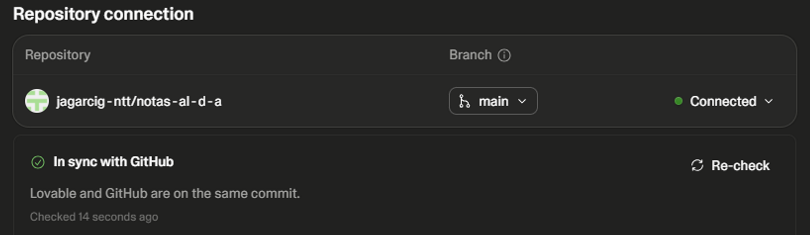
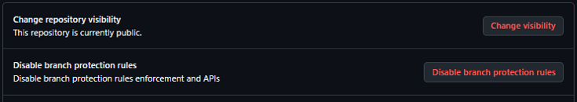
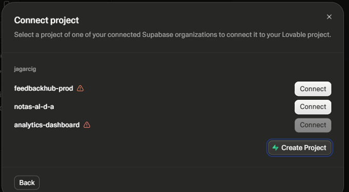
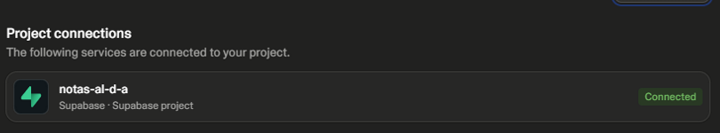
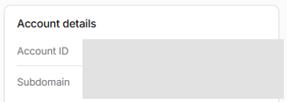
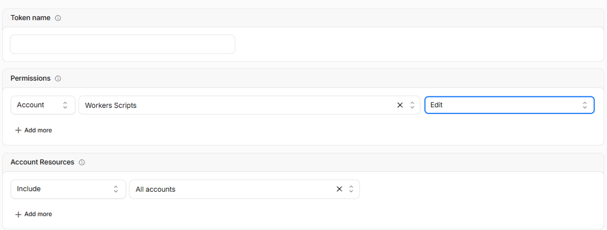
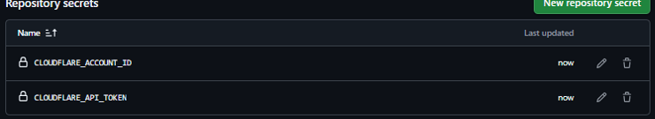

# Prepárate para la sesión de Git y Deploy

**AI PM Pro · The Hero Camp · Sábado 21 de noviembre · 10:00–14:00 · Zoom**

El día 21 publicarás tu producto de Lovable en Internet, con un sistema profesional de cambios. Para aprovechar la sesión, llega con estas cuentas preparadas. Solo necesitas el navegador: no hay que instalar nada.

**Tiempo estimado:** unos 30 minutos.

## ¿Lo tienes?

| ✔ | Qué | Cuándo |
|---|---|---|
| ☐ | Plan Pro de Lovable activo | Antes del 21-nov |
| ☐ | Proyecto de Lovable conectado a GitHub, con el repositorio **público** | Antes del 21-nov |
| ☐ | Cuenta de Supabase creada | Antes del 21-nov |
| ☐ | Supabase **conectado a tu proyecto**, antes de crear ninguna tabla | Antes del 21-nov |
| ☐ | Cuenta de Cloudflare, token y Account ID | Antes del 21-nov |
| ☐ | Token y Account ID guardados en GitHub | Antes del 21-nov |

**Tres reglas de oro**

1. **Tu repositorio será público.** No incluyas nunca información confidencial de tu empresa ni datos reales de personas.
2. **El token es una contraseña.** No lo compartas, no lo pegues en el chat de Lovable y no lo enseñes en pantalla: las clases se graban.
3. **Conecta Supabase antes de crear tablas.** No actives el backend de Lovable.

**¿Te atascas?** Escribe a Gema por el Slack del curso, con una captura en la que no se vea ningún token.

**El día de la sesión** compartiremos el portal con todo el material: https://jagarcig-ntt.github.io/ai-pm-pro-seguridad/sesiones/2026-11-git-deploy/

## Paso 1 · Conecta Lovable con GitHub

1. Crea tu proyecto en Lovable, si aún no lo tienes. **Ponle un nombre sin tildes ni eñes:** se usa para el repositorio y para tu dirección web.
2. Crea una cuenta en [github.com](https://github.com) si no la tienes.
3. En Lovable, abre *Settings → Git* y conecta tu proyecto con GitHub.
4. Comprueba que aparece **Connected** y **In sync with GitHub**.

5. En GitHub, abre tu repositorio y ve a *Settings → General*. Baja hasta *Danger Zone*.
6. Pulsa *Change visibility* y elige **Public**.
7. Comprueba que pone *This repository is currently public*.

> **No renombres ni muevas el repositorio** después de conectarlo: Lovable perdería la conexión.

## Paso 2 · Conecta Supabase

Aquí se guardarán los datos de tu producto.

1. Crea una cuenta gratuita en [supabase.com](https://supabase.com).
2. **Antes de crear ninguna tabla,** en Lovable abre *More → Connectors → Supabase*. **No uses *Database*:** eso activa el backend de Lovable.
3. Autoriza el acceso y pulsa **Create Project**.

4. Comprueba que tu proyecto aparece como **Connected**.

A partir de aquí, todo se pide en el chat de Lovable. Cuando cree una tabla, te enseñará el cambio y te pedirá permiso.

> **Si ya has activado el backend de Lovable,** no intentes cambiarlo por tu cuenta. Avisa a Jose.

## Paso 3 · Prepara Cloudflare

Aquí se publicará tu producto.

1. Crea una cuenta gratuita en [cloudflare.com](https://dash.cloudflare.com/sign-up).
2. Entra en *Workers & Pages*. Déjala abierta: en la columna de la derecha está tu **Account ID**. Lo necesitarás en el paso 4.

3. Haz clic en tu perfil y ve a *My Profile → API Tokens → Create Token → Create Custom Token*.
4. Rellena el formulario así:
    - **Token name:** el nombre de tu proyecto.
    - **Permissions:** `Account` · `Workers Scripts` · `Edit`.
    - **Account Resources:** `Include` · `All accounts`.
    - **Token expiration:** `1 year`.

5. Pulsa *Continue to summary* y después *Create Token*.
6. **Copia el token.** Cloudflare solo lo enseña una vez. Si lo pierdes, crea otro.

## Paso 4 · Guarda el token en GitHub

Así tu repositorio podrá publicar sin que el token aparezca en ningún sitio.

1. En tu repositorio de GitHub, ve a *Settings → Secrets and variables → Actions*.
2. Pulsa *New repository secret*.
3. **Name:** `CLOUDFLARE_API_TOKEN`. **Secret:** tu token. Pulsa *Add secret*.
4. Repite con **Name:** `CLOUDFLARE_ACCOUNT_ID` y tu Account ID como **Secret**.
5. Comprueba que ves los dos, con estos nombres exactos.

**¡Ya está!** Revisa la lista de la primera página.

## Costes y límites

| Servicio | Coste | A tener en cuenta |
|---|---|---|
| Lovable | Plan Pro, 25 €/mes | Lo contrata cada alumno |
| GitHub | Gratis | Las automatizaciones son gratuitas en repositorios públicos |
| Supabase | Gratis | Máximo 2 proyectos activos. **Se pausa tras 1 semana sin uso:** si tu producto deja de funcionar, reactívalo desde el panel de Supabase. Compruébalo antes del Demo Day |
| Cloudflare | Gratis | 100.000 peticiones al día, de sobra para el curso |

Datos consultados el 5-nov-2026: acuerdo del curso (Lovable), docs.github.com (Actions), supabase.com/pricing y panel de Cloudflare Workers.

